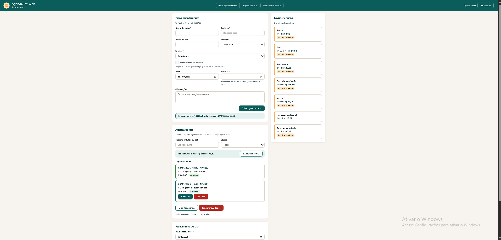

# AgendaPet Web

Painel web de agendamentos para o pet shop **Patinhas & Cia**: banho, tosa, consulta veterinária, vacina, hospedagem e adestramento.

Projeto Avaliativo M1.2 do curso Front-End React T4 (SENAI SC), desenvolvido em uma sprint de duas semanas (16/10 a 30/10/2026).



## O que o sistema faz e para quem serve

O AgendaPet é usado pela **atendente do pet shop**, no computador ou no celular/tablet da bancada. Ele substitui o WhatsApp e o caderno, evitando horários marcados duas vezes, atendimentos em feriado sem aviso, endereços anotados errado e a falta de controle do caixa.

- **Catálogo de serviços** com preço, duração e indicação de atendimento a domicílio.
- **Novo agendamento** com validação: campos obrigatórios, telefone, data não passada e horário de funcionamento.
- **Endereço automático pelo CEP** (ViaCEP) nos atendimentos a domicílio.
- **Aviso de feriado** (BrasilAPI), com confirmação "Agendar mesmo assim".
- **Agenda do dia** ordenada por horário, com busca, filtro por status, botões Concluir e Cancelar e atalhos de teclado.
- **Regras de negócio:** protocolo sequencial (AP-0001), bloqueio de horário duplicado e taxa de deslocamento no domicílio.
- **Fechamento do dia:** atendimentos, faturamento dos concluídos, previsto, cancelados, quantidade por serviço e próximo atendimento.
- **Dados salvos no navegador:** a agenda, o filtro e o tema (claro/escuro) continuam depois de recarregar a página.
- **Relógio e lembretes:** próximo atendimento, aviso a 15 minutos, atrasados e avisos temporários.
- **Terminal:** fechamento do dia e validação dos dados com Node.js.

## Como executar

**Requisito:** Node.js 18 ou superior (testado com Node.js v24.19.0 LTS).

```bash
git clone https://github.com/Montteiro11/agendapet-web.git
cd agendapet-web
npm install
npm start
```

- `npm start` sobe o servidor local e abre a página em `http://127.0.0.1:8080`.
- Não abra o `index.html` com duplo clique: o projeto usa `fetch` e módulos ES, que só funcionam por um servidor.
- `npm test` roda os testes automáticos.
- `npm run fechamento` mostra o fechamento do dia no terminal.
- `npm run validar` valida o arquivo de agenda.

## Arquitetura cliente-servidor

O **cliente** é o navegador: ele mostra a página e executa o JavaScript. O **servidor** responde aos pedidos do cliente com arquivos ou dados.

| Pedido do cliente (`fetch`) | Servidor que responde | O que volta |
|---|---|---|
| `./data/servicos.json` | Servidor local do projeto (`http-server`, via `npm start`) | Catálogo de serviços (US02) |
| `https://viacep.com.br/ws/{cep}/json/` | ViaCEP, na internet | Endereço do CEP (US04) |
| `https://brasilapi.com.br/api/feriados/v1/{ano}` | BrasilAPI, na internet | Feriados do ano (US05) |

Todas as requisições ficam em `js/api.js`. Quando um servidor não responde, a página mostra um aviso e continua funcionando: "Tentar novamente" no catálogo, preenchimento manual no CEP e "você pode continuar" nos feriados.

## Organização do código

| Pasta / arquivo | Responsabilidade |
|---|---|
| `index.html` | Estrutura semântica da página |
| `css/style.css` | Estilos, variáveis, Flexbox, breakpoints e tema escuro |
| `js/app.js` | Ponto de entrada: liga os eventos e coordena os outros módulos |
| `js/ui.js` | Tudo o que mexe na tela (DOM) |
| `js/api.js` | Requisições com `fetch` |
| `js/storage.js` | Único acesso ao `localStorage` |
| `js/dominio/` | Regras de negócio **sem DOM**, usadas na página e no Node: `agendamento.js`, `regras.js`, `fechamento.js` e `lembretes.js` |
| `scripts/` | Scripts de terminal (`fechamento-dia.js` em ESM e `validar-agenda.cjs` em CommonJS) |
| `tests/` | Testes automáticos do domínio |
| `data/` | Catálogo de serviços, agenda de exemplo e agenda com erros de propósito |

## Regras e decisões

### Formulário de agendamento (US03)
- **Horário de funcionamento:** 08:00 às 18:00. O último atendimento começa às 17:30.
- **Data:** não pode estar no passado. Se a data for hoje, o horário também não pode ter passado.
- **Telefone:** DDD + número, com 10 dígitos (fixo) ou 11 (celular). Parênteses, espaços e hífen são aceitos.
- **Espécies:** Cão, Gato ou Outro.
- **Validação:** feita em JavaScript no evento `submit` (com `preventDefault`), em `js/dominio/regras.js`. As mensagens aparecem na tela (sem `alert`), o resumo é anunciado com `role="alert"` e o foco vai para o primeiro campo inválido.

### Endereço por CEP (US04)
- O checkbox **Atendimento a domicílio** só fica liberado para serviços com `"domiciliar": true` no `servicos.json` (a hospedagem não atende a domicílio).
- Ao completar 8 números no CEP (com ou sem hífen), a página consulta `https://viacep.com.br/ws/{cep}/json/` e preenche rua, bairro, cidade e UF. Número e complemento são digitados.
- Cada falha tem uma mensagem própria: **CEP inválido** (menos de 8 números), **CEP não encontrado** (o ViaCEP responde `"erro": true`) e **sem conexão** (o `fetch` falha).
- Os campos de endereço nunca ficam bloqueados: se o ViaCEP estiver fora do ar, a atendente digita o endereço à mão.
- O endereço é obrigatório apenas quando o atendimento é a domicílio.

### Alerta de feriados (US05)
- Ao escolher a data, a página consulta `https://brasilapi.com.br/api/feriados/v1/{ano}`.
- A lista do ano fica guardada no `localStorage` na chave `agendapet:feriados:{ano}`, junto com a data da consulta. **Validade do cache: 30 dias.** Enquanto o cache vale, não há nova requisição, nem depois de recarregar a página.
- Se a data for feriado, aparece o nome do feriado e o agendamento só é salvo depois de marcar **"Agendar mesmo assim"**.
- Se a BrasilAPI falhar, aparece o aviso "Não foi possível verificar feriados agora" e o agendamento pode continuar normalmente.
- Todo acesso ao `localStorage` passa por `js/storage.js`, com `try/catch`: um valor corrompido não quebra a página.

### Agenda do dia (US06)
- A lista é montada por JavaScript (`createElement`, `textContent` e `classList`), **ordenada por data e horário**, com o status Agendado, Concluído ou Cancelado.
- **Mouse:** botões **Concluir** e **Cancelar** (só para quem está Agendado), destaque ao passar o mouse (`mouseover`/`mouseout`) e seleção do item com clique, que mostra telefone, espécie e observações.
- **Teclado:** todos os itens e botões são alcançáveis com **Tab**; **Enter** ou **Espaço** selecionam o item.
- **Busca em tempo real** por tutor ou pet (evento `input`), sem diferenciar maiúsculas de minúsculas nem acentos.
- **Filtro por status** e contador "X agendamentos", com mensagem própria para lista vazia e para busca sem resultado.
- **Atalhos:** `N` vai ao formulário, `/` foca a busca e `Esc` limpa a busca. Os atalhos `N` e `/` não funcionam enquanto se digita em um campo, para não atrapalhar.
- **Exportar agenda:** mostra o JSON formatado para copiar, no mesmo formato que será lido pelos scripts de Node (US11). Bônus: botão para baixar como arquivo `.json`.
- A busca, o filtro e a ordenação ficam em `js/dominio/regras.js` (`filtrarAgenda`), sem DOM, e têm testes em `npm test`.

### Regras de negócio e fechamento do dia (US07)
- **Classes** (`js/dominio/agendamento.js`): `Agendamento` guarda os dados e tem os métodos `calcularValor()`, `resumo()`, `concluir()`, `cancelar()` e `estaAtivo()`. A subclasse `AgendamentoDomiciliar extends Agendamento` acrescenta o `endereco` e sobrescreve `calcularValor()`, `resumo()` e `toJSON()`.
- **Taxa de deslocamento:** valor fixo de **R$ 20,00** somado ao preço do serviço nos atendimentos a domicílio.
- **Conflito:** não é possível salvar dois agendamentos **ativos** (Agendado ou Concluído) no mesmo dia e horário. Um agendamento cancelado libera o horário.
- **Protocolo:** sequencial no formato `AP-0001`, gerado por uma **closure** (`criarGeradorDeProtocolo`), que guarda o contador sem variável global. Um protocolo só é gerado quando o agendamento é salvo de fato.
- **Callback:** `filtrarAgendamentos(lista, criterio)` recebe a função que decide quem entra no resultado.
- **Fechamento do dia** (`js/dominio/fechamento.js`):
  - *Atendimentos*: agendamentos do dia que não foram cancelados.
  - *Faturamento*: soma do valor apenas dos **concluídos**.
  - *Previsto*: soma do valor dos que ainda estão como Agendado.
  - *Cancelados* e *quantidade por serviço*.
  - *Próximo atendimento*: o Agendado de horário mais cedo (se o dia for hoje, só os que ainda não passaram).
  - Usa os métodos de array `filter`, `reduce`, `sort`, `find`, `some`, `every` e `map`, e os laços `for` e `for...of`.

### Persistência e exportação dos dados (US08)
- A agenda, o **filtro de status** e o **tema** (claro ou escuro) ficam salvos no `localStorage` e voltam depois de recarregar a página (F5).
- Todo acesso passa por `js/storage.js`, com `JSON.stringify` e `JSON.parse` dentro de `try/catch`. Se um valor salvo estiver corrompido, a página abre normalmente (vazia) e um aviso aparece no console. Itens inválidos dentro da agenda são ignorados.
- **Chaves usadas** (todas com o prefixo `agendapet:`): `agendapet:agenda`, `agendapet:filtro`, `agendapet:tema` e `agendapet:feriados:{ano}`.
- Ao carregar, cada item salvo volta a ser um `Agendamento` ou `AgendamentoDomiciliar` (com os métodos), e o protocolo continua do último número usado.
- **Limpar meus dados:** apaga **somente** as chaves que começam com `agendapet:`; dados de outros sites ficam intactos. Para evitar acidentes, pede um segundo clique de confirmação (sem usar `confirm()`).
- **Tema escuro:** todas as cores do CSS são variáveis. O JavaScript coloca `data-tema="escuro"` na tag `<html>` e a regra `:root[data-tema="escuro"]` troca só os valores das variáveis.
- **Exportar agenda:** continua mostrando o JSON formatado, no mesmo formato salvo no `localStorage`.

### Relógio e lembretes de atendimento (US09)
- **setInterval** a cada **30 segundos** atualiza o relógio do cabeçalho, o texto "Próximo atendimento: … (em X min)", os atrasados e o "Próximo atendimento" do fechamento.
- **Atrasado:** atendimento de hoje cujo horário já passou e que continua como Agendado. Ganha a etiqueta vermelha "Atrasado há X min" e a borda vermelha.
- **Lembrete visual:** faltando **15 minutos ou menos**, o atendimento ganha a etiqueta "Em X min" e a borda laranja, e aparece um aviso (uma única vez por atendimento).
- **setTimeout:** os avisos temporários (toast) de lembrete, concluir, cancelar, pausar e limpar dados somem sozinhos depois de alguns segundos. Se chegar um aviso novo, o timer anterior é cancelado com `clearTimeout`, então os timers nunca se acumulam.
- **Pausar/Retomar lembretes:** o botão chama `clearInterval` e guarda `null` no lugar do id do timer. Ao retomar, um novo `setInterval` só é criado se não houver outro rodando (sem timers duplicados).
- O cálculo fica em `js/dominio/lembretes.js` (sem DOM e sem timers), com testes em `npm test`.

### const, let e var
| Palavra | Pode receber outro valor? | Escopo | Uso no projeto |
|---|---|---|---|
| `const` | Não | Bloco `{ }` | Padrão para tudo que não muda: funções, elementos do DOM, o array `agendamentos` (o conteúdo muda com `push`, mas a variável aponta sempre para o mesmo array). |
| `let` | Sim | Bloco `{ }` | Valores que mudam: `servicos`, o `contador` do protocolo, `feriadoDaData`, o `i` do laço `for`. |
| `var` | Sim | Função inteira (ignora o bloco) | **Não usamos.** O `var` "vaza" para fora de `if` e `for`, pode ser usado antes de ser declarado (hoisting, vale `undefined`) e pode ser declarado duas vezes sem erro. Isso causa bugs difíceis de achar; `const` e `let` evitam esses problemas. |

### Testes automáticos (bônus)
- `npm test` roda `tests/dominio.test.js` com o executor de testes que já vem no Node (`node:test`), sem instalar nada.
- São 14 testes cobrindo os cenários de aceite da US06, US07 e US09: ordem, busca e filtro da agenda, taxa do domiciliar, conflito de horário, protocolos sequenciais, faturamento só dos concluídos, contagem por serviço e cancelados, e cálculo dos lembretes.

## Conceitos do Módulo 01 aplicados

| Conceito | Onde (arquivo e função) |
|---|---|
| HTML semântico, acessibilidade e SEO | `index.html`: `header`, `nav`, `main`, `section`, `aside`, `footer`, um único `h1`, skip link, `label` em todos os campos, `aria-live`, `meta description` |
| Formulário + JavaScript | `js/app.js` → `aoEnviarFormulario` (`submit` com `preventDefault`); `js/dominio/regras.js` → `validarAgendamento` |
| CSS, Flexbox, variáveis, responsividade | `css/style.css`: variáveis no `:root`, layout em Flexbox, breakpoints de 768px e 1280px, mobile-first |
| DOM: seletores e manipulação | `js/ui.js` → `mostrarAgenda`, `criarItemAgenda` (`querySelector`, `createElement`, `textContent`, `classList`) |
| Eventos de mouse e teclado | `js/app.js`: `click` e `mouseover`/`mouseout` na lista (delegação), `input` na busca, atalhos `N`, `/` e `Esc` no `keydown` |
| `fetch` e `async/await` | `js/api.js` → `buscarServicos`, `buscarEndereco`, `buscarFeriados` |
| `localStorage` | `js/storage.js` → `lerJSON`, `salvarJSON`, `removerDadosDoApp` |
| `setInterval` e `setTimeout` | `js/app.js` → `iniciarLembretes`, `pausarLembretes` (`clearInterval`); `js/ui.js` → `mostrarToast` (`setTimeout`/`clearTimeout`) |
| Classes, construtor, herança e `this` | `js/dominio/agendamento.js` → `Agendamento` e `AgendamentoDomiciliar extends Agendamento` (`super`, métodos sobrescritos) |
| Closure | `js/dominio/agendamento.js` → `criarGeradorDeProtocolo` |
| Callback | `js/dominio/regras.js` → `filtrarAgendamentos(lista, criterio)` |
| Promises | `js/app.js` → `verificacaoFeriado` (o `submit` espera a Promise com `await`) |
| Métodos de array e laços | `js/dominio/fechamento.js` → `filter`, `reduce`, `sort`, `every`, laço `for`; `js/dominio/regras.js` → `find`, `some`, `map`, `for...of` |
| Estruturas de decisão | `if/else` em `validarAgendamento`, `switch` em `classeDoStatus` (`js/ui.js`), ternários nas mensagens |
| Módulos (`export`/`import`) | Todos os arquivos de `js/` e `scripts/fechamento-dia.js` |

## Especificidade no CSS: um conflito real

**Problema:** o grupo de endereço (`<fieldset class="endereco" hidden>`) continuava aparecendo na tela, mesmo com o atributo `hidden`.

**Causa:** o `hidden` funciona porque o navegador aplica `display: none` com um estilo padrão de baixa prioridade. A minha regra `.endereco { display: flex; }` é uma regra do autor da página e por isso vence o estilo do navegador.

**Solução, sem `!important` e sem `id`:** uma regra mais específica, com classe + atributo (especificidade 0,2,0), que só vale quando o elemento está escondido:

```css
.endereco[hidden] {
  display: none;
}
```

O mesmo cuidado foi usado em `.feriado[hidden]` e `.exportacao[hidden]`. Outro caso do projeto: o contorno de foco global (`:focus-visible`) era verde-escuro e sumia no menu verde; a regra `.menu__link:focus-visible` (0,2,0) troca a cor para branco só ali.

## Node.js: scripts, pacotes e módulos (US11)

### Scripts do `package.json`

| Comando | O que faz |
|---|---|
| `npm start` | Sobe o servidor local (`http-server`) e abre a página. |
| `npm test` | Roda os testes automáticos do domínio (`node:test`). |
| `npm run fechamento` | Imprime no terminal o fechamento do dia lendo `data/agenda-exemplo.json`. Aceita um dia e um arquivo: `npm run fechamento -- 2026-10-30 data/agenda-exemplo.json`. |
| `npm run validar` | Valida `data/agenda-exemplo.json` (campos obrigatórios, data e hora válidas, status, endereço do domiciliar, protocolo repetido e conflito de horário). Aceita outro arquivo: `npm run validar -- data/agenda-invalida.json`. Termina com `process.exit(1)` se houver erro. |

- `data/agenda-exemplo.json` tem 10 agendamentos no mesmo formato do botão **Exportar agenda** da página, então um arquivo exportado também pode ser validado e fechado pelos scripts.
- `data/agenda-invalida.json` tem erros de propósito, para demonstrar o validador.
- `scripts/fechamento-dia.js` importa os **mesmos módulos** de `js/dominio/` usados na página: a regra do fechamento é uma só, no navegador e no terminal.

### Instalação local x global

| | Local (`--save-dev`) | Global (`-g`) |
|---|---|---|
| Onde fica | Na pasta `node_modules/` do projeto | Numa pasta do computador, fora do projeto |
| Quem usa | Só este projeto | Qualquer pasta, pelo terminal |
| Vai para o `package.json`? | Sim, em `devDependencies` | Não |
| Quem clona o projeto | Instala tudo com `npm install` | Precisa instalar por conta própria |
| Quando usar | Ferramentas de que o projeto depende (servidor, testes, linter) | Ferramentas de uso geral do computador |

- **O que instalei e onde:** o `http-server` foi instalado **localmente** como dependência de desenvolvimento (`npm install --save-dev http-server`) e é usado pelo `npm start`. Não instalei nada globalmente para este projeto: assim, quem clonar o repositório só precisa do Node.js e de um `npm install`.
- **Comandos:**
  - `npm install --save-dev http-server`: instala localmente, como dependência de desenvolvimento.
  - `npm install -g <pacote>`: instala globalmente (não usado neste projeto).
  - `npm ls`: lista os pacotes instalados no projeto.
  - `npm ls -g --depth=0`: lista os pacotes globais, só o primeiro nível.
  - `npx http-server`: executa um pacote sem instalar globalmente (usa o local, se existir).

### CommonJS x ESM

| | CommonJS | ESM (ES Modules) |
|---|---|---|
| Importar | `const fs = require('fs')` | `import { readFile } from 'node:fs/promises'` |
| Exportar | `module.exports = { ... }` | `export function ...` |
| Extensão | `.cjs` (ou `.js` sem `"type": "module"`) | `.mjs` (ou `.js` com `"type": "module"`) |
| `"type"` no `package.json` | padrão do Node quando não há `"type"` | `"type": "module"` |
| Carregamento | Síncrono, na hora em que o `require` roda | Analisado antes de executar; permite `await` no topo do arquivo |
| No navegador | Não funciona sem ferramenta extra | Funciona com `<script type="module">` |

- **Escolha:** o projeto usa **ESM** (`"type": "module"`) porque o mesmo código de `js/dominio/` precisa rodar no navegador e no Node, e o navegador só entende `import`/`export`. O `scripts/validar-agenda.cjs` é **CommonJS** de propósito, com `require` de `fs` e `path`, para mostrar o outro formato: a extensão `.cjs` faz o Node tratá-lo como CommonJS mesmo com `"type": "module"`.

## Depuração e relatório de bug (US12)
- `.vscode/launch.json` tem três configurações: **Depurar fechamento do dia (Node)**, **Depurar testes do domínio (Node)** e, opcional, **Depurar página no Chrome**.
- Para praticar, foi introduzido um **erro controlado** no fechamento (o faturamento somava os cancelados). Ele foi encontrado com **breakpoint**, **breakpoint condicional**, inspeção de variáveis, **Watch** e **Call Stack**, e corrigido em um commit `fix`.
- Relatório completo em [docs/bug-report.md](docs/bug-report.md), com a evidência em `docs/depuracao.png`.

## Sprint

- **Meta:** entregar à Patinhas & Cia um painel web que cadastre, valide e acompanhe os agendamentos do dia, com fechamento do caixa no navegador e no terminal.
- **Planejamento:** [planejamento/sprint-planning.md](planejamento/sprint-planning.md)
- **Kanban:** https://trello.com/b/E3kSs9mz/agendapet-web-sprint (print final em `docs/kanban.png`)
- **Pontos planejados:** 48 · **Pontos entregues:** 48 (as 12 histórias), mais 1 ponto de trabalho não planejado (AJ01, correção do nome da autora).
- **O que ficou de fora:** nada do backlog. Dos bônus, foram feitos os testes automáticos e o download do JSON exportado; não foram feitos o GitHub Pages e os estilos de impressão (`@media print`).
- **Mudança de ordem:** a US07 (regras e classes) foi feita antes da US06 (agenda), porque a agenda usa as classes e os status da US07.

## Retrospectiva

**O que funcionou (manter)**
- Trabalhar um ticket por vez, cada um com a sua branch e o seu Pull Request: o histórico ficou organizado e fácil de revisar.
- Testar os cenários de aceite de cada história antes do commit e guardar um print como evidência no PR.
- Os testes automáticos (`npm test`), que pegaram o erro do fechamento antes de ele chegar à tela.

**O que não funcionou (parar de fazer)**
- Começar a sprint atrasada: o setup e as primeiras histórias foram feitos só no dia 20/10.
- Mexer em arquivos pelo Explorador sem conferir: uma vez, arquivos do projeto sumiram da pasta e precisaram ser recuperados pelo GitHub Desktop ("Discard changes").
- Aceitar dados gerados sem revisar: o nome da autora saiu errado e precisou de um ajuste (AJ01).

**O que eu faria diferente (começar a fazer)**
- Fazer o Sprint Planning e o setup logo no primeiro dia.
- Ler e entender cada arquivo antes de copiar para o projeto, e escrever mais partes do código sozinha.
- Conferir o GitHub Desktop antes de cada commit, olhando se algum arquivo aparece como apagado.
- Usar o Trello desde o começo: o GitHub Projects tinha automações que tiravam os cartões do quadro.

## Sprint Review por escrito (item 4.6)

Respostas às perguntas da apresentação, para consulta do cliente e do professor.

**1. Demonstração para o cliente**
Fluxo completo, com evidências nos Pull Requests e em `docs/`:
- *Agendamento comum:* preencher o formulário e salvar. A página não recarrega, mostra "Agendamento AP-0001 salvo" e o item entra na agenda (`js/app.js` → `aoEnviarFormulario`).
- *Agendamento domiciliar com CEP:* escolher Banho, marcar "Atendimento a domicílio" e digitar `01001000`. Rua, bairro, cidade e UF são preenchidos, e o valor ganha R$ 20,00 de taxa (`js/api.js` → `buscarEndereco`; `AgendamentoDomiciliar.calcularValor`).
- *Aviso de feriado:* escolher 25/12/2026. Aparece "Natal" e só salva marcando "Agendar mesmo assim" (`js/api.js` → `buscarFeriados`).
- *Conflito de horário:* repetir dia e horário de um agendamento ativo. Aparece "Horário ocupado: AP-000X…" (`js/dominio/regras.js` → `encontrarConflito`).
- *Mudança de status:* botões Concluir e Cancelar na agenda (`Agendamento.concluir` e `cancelar`).
- *Fechamento do dia:* faturamento só dos concluídos, previsto, cancelados e quantidade por serviço (`js/dominio/fechamento.js` → `calcularFechamento`).
- *Recarregar a página:* agenda, filtro e tema voltam iguais (`js/storage.js` e `carregarAgendaSalva` em `js/app.js`).
- *Tela no celular:* layout em uma coluna em 360px, sem rolagem horizontal, com botões fáceis de tocar.

**2. O que fazer para executar o sistema**
`git clone` do repositório, `npm install` e `npm start` para a página; `npm run fechamento` e `npm run validar` no terminal. Detalhes na seção [Como executar](#como-executar).

**3. Como foi o Sprint Planning**
As 12 histórias viraram cartões no Trello, estimadas em pontos de Fibonacci (total de 48). A meta, a ordem de execução, os riscos e o que seria cortado estão em [planejamento/sprint-planning.md](planejamento/sprint-planning.md). Os cartões passaram por Backlog → A Fazer → Em Andamento → Revisão → Concluído, cada um com o nome da branch e o link do PR.

**4. Branches e Pull Requests**
Uma branch por ticket, no padrão `tipo/ticket`, cada uma integrada à `main` por um Pull Request com o modelo preenchido (o que mudou, ticket, como testar, evidência e checklist):
`chore/setup-projeto` · `feat/US01-US10-estrutura-layout` · `feat/US02-catalogo` · `feat/US03-formulario` · `feat/US04-cep` · `feat/US05-feriados` · `feat/US07-regras-fechamento` · `chore/corrige-autor` · `feat/US06-agenda` · `feat/US08-persistencia` · `feat/US09-lembretes` · `feat/US11-scripts-node` · `fix/US12-faturamento-cancelados` · `docs/fechamento-sprint`.
Lista completa: https://github.com/Montteiro11/agendapet-web/pulls?q=is%3Apr

**5. Node.js: ESM, CommonJS e instalação**
O projeto é ESM (`"type": "module"`): a página e o `scripts/fechamento-dia.js` usam `import`/`export`. O `scripts/validar-agenda.cjs` é CommonJS, com `require` e `module.exports`. O `http-server` foi instalado **localmente** como dependência de desenvolvimento (`npm install --save-dev http-server`); nada foi instalado globalmente. Detalhes na seção [Node.js](#nodejs-scripts-pacotes-e-módulos-us11).

**6. Depuração**
Com um erro controlado (o faturamento somava os cancelados), o VS Code foi pausado com um breakpoint na linha do `filter` e um breakpoint condicional dentro do `reduce`. As Variáveis, o Watch (`concluidos.map(a => a.status)`) e a Call Stack mostraram um atendimento cancelado dentro da lista de concluídos. Relatório em [docs/bug-report.md](docs/bug-report.md), print em `docs/depuracao.png`.

**7. Retrospectiva**
Na seção [Retrospectiva](#retrospectiva).

## Uso de Inteligência Artificial

Este projeto foi desenvolvido com o apoio de uma IA (Claude, da Anthropic), como permite o item 4.6 do enunciado, que pede para declarar onde a IA foi usada e o que foi validado.

**Onde usei IA**
- O código das histórias foi gerado pela IA, em etapas e com comentários. Eu **digitei cada arquivo à mão**, em vez de copiar e colar, para fixar o conteúdo, e tirei dúvidas com a IA linha por linha sobre o que cada parte fazia e quais ajustes eram necessários em cada etapa.
- Textos de apoio: sprint planning, regras deste README, descrições dos Pull Requests e o relatório de bug.
- Orientação passo a passo no uso do GitHub Desktop, do Trello, do DevTools do navegador, do terminal e do depurador do VS Code.

**O que eu fiz e validei**
- Organizei e movimentei o Kanban ao longo da sprint.
- Criei cada branch, fiz os commits e abri, revisei e integrei cada Pull Request.
- Testei no navegador todos os cenários de aceite, inclusive com as APIs reais (ViaCEP e BrasilAPI), o modo offline, o cache e os dados corrompidos no `localStorage` e a tela de celular, e registrei as evidências nos PRs.
- Rodei os testes automáticos e os scripts de terminal.
- Operei o depurador do VS Code para encontrar o erro controlado e fiz a correção da linha.
- Digitei todo o código do projeto à mão, acompanhando cada etapa, e estudei os arquivos para conseguir explicar o que cada um faz.

## Extensões do VS Code

- **Prettier**: formatação do código (usada no projeto).
- **ESLint**: recomendada, para apontar erros comuns de JavaScript.
- **Live Server**: alternativa ao `npm start` para abrir a página com servidor local.
- O depurador de Node.js e de Chrome já vem com o VS Code (usado na US12).

## Autoria

Desenvolvido por **Vanessa Monteiro Paim**.
